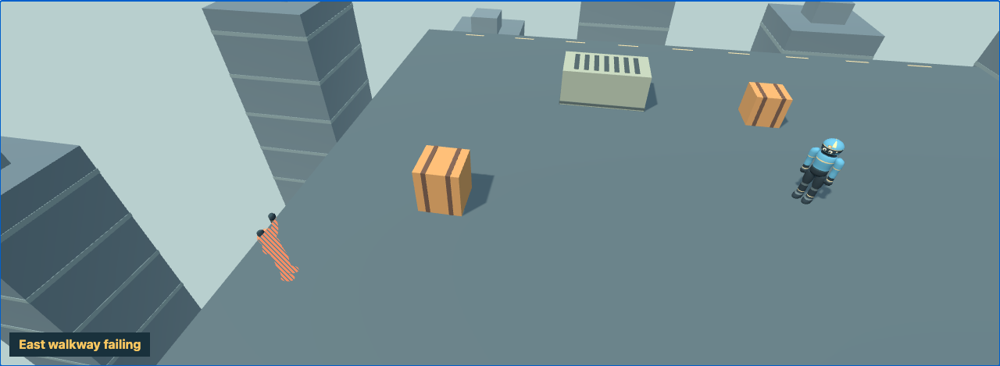

# Seeing a fighter behind the roof

In the [west-edge rescue](10e-ledge-rescue.md), the camera framed the hanging fighter correctly but the roof covered most of their body. The HUD identified the gripping hand. It gave no indication of where the other arm or legs were swinging.

Skyline now shows diagonal stripes in the fighter’s team color over the hidden parts of their pose. At each pixel the opaque arena has already written its depth. The striped mesh draws only when its surface is farther from the camera than that depth. Gaps in the stripes let the roof or prop show through. The regular suits draw last with normal depth testing, so hands in front of the roof and the fighter in front of a grapple retain their normal lighting and markings.

Each visible fighter adds one skinned draw to the color pass. It reuses the suit geometry, skeleton, bone texture and bind matrix. It has one unlit material, writes no depth, and casts no shadow. Eliminating the fighter hides the entire rig. Scene disposal releases the material with its owner. Local players, private-room players and spectators share this renderer. [Renderer](../../web/src/rendering/fighter/occludedSilhouette.ts)

## Verification

- The local west-walkway fixture reproduced the original failure with zero silhouette pixels while the player held the roof. The rendered regression checks the suspended fighter in landscape and portrait. From the exposed side of the roof, a 90° orbit removes most of the stripes. The other fighter remains ordinarily lit, and Space still returns the climber to the same round. [Local rescue](../../web/tests/skyline-mantle.spec.ts)
- The skin regression compares positions of shared vertices under animated limb rotations and a translated, rotated and scaled scene root. [Pose verification](../../web/src/rendering/fighter/FighterSkin.test.ts)
- In a controlled Chromium scene the same crate moved fully in front, partly across and behind a stationary fighter. The fully covered view produced over 200 team-color pixels. Partial coverage produced between 15% and 85% of that area. The count returned to zero with the crate behind the fighter, with the crate retired and with the fighter eliminated. [Moving-crate regression](../../web/tests/skyline-occlusion.spec.ts)
- In the production build, two private-room players saw the west-walkway collapse with 60 ms of added message delay each way on the climber’s connection. The climber’s captured frame contained 988 team-color silhouette pixels across 78 rows. The other player’s capture contained 1,248 across 80 rows. Both saw the rescue and subsequent walk on the deck. An eight-player room also ran through a replicated elimination. [Private-room rescue](../../web/tests/online-ledge.spec.ts) and [eight-player verification](../../web/tests/online-roster.spec.ts)

The 71 web unit tests, TypeScript check and production build passed. Chromium covered both player views, eight-player replication, model loading and retry, local and online camera controls, scoring, rematch and viewport resize. The eight-player case establishes functional behavior. GPU frame-time budgets, camera collision clearance and human readability remain separate acceptance items.
