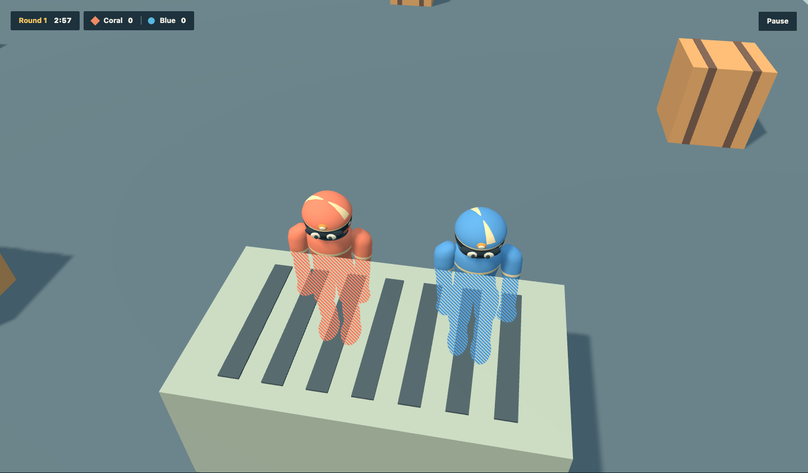

# Skyline camera clearance

Skyline checks the path from the camera's aim point to the intended lens position each draw. The local and online renderers use the same check. It reads the same object positions, orientations and visibility used to draw the deck, vents, crates and walkways. The roof foundation and the main volumes of nearby buildings and their rooftop units also participate. Thin decorative trim uses its parent's volume. A retired walkway leaves the camera query when it leaves the rendered scene. [Arena geometry](../../web/src/rendering/SkylineView.ts) · [Collision query](../../web/src/rendering/CameraObstacles.ts)

## View selection

The near plane's corners fit inside the probe sphere. Its minimum radius is 0.15 m. For each oriented box, the query transforms the ray into the box's local coordinates and expands the three faces by the radius. This conservatively includes corner grazes. The nearest intersection within the proposed camera distance limits the usable space.

1. Shorten the camera distance if every tracked limb still fits the central 70% of the view. Leave 0.01 m clearance before the first contact.
2. For a low obstacle, lift the aim if its expanded top is within 0.65 m above the ordinary group focus. This keeps the familiar rooftop pitch when fighters press against a vent. The correction eases down after the path clears.
3. For a taller obstruction, try steeper and shallower pitches on the same horizontal heading. Recalculate full-body framing for every candidate. A shallow view can stay beneath an overhead panel.
4. If the focus begins inside a solid, or every allowed pitch is obstructed, lift the aim above the blocking volume and check again. Each retry clears that volume on every upward ray. The view retains a prior clear correction when easing toward the ordinary view would put the lens back into an obstruction.

Clearance changes camera presentation only. Orbit continues to determine the horizontal movement axes. A fighter behind opaque geometry still gets a team-color silhouette on the covered limbs. [Group camera](../../web/src/rendering/GroupCamera.ts) · [Inset calculation](../../web/src/rendering/CameraFit.ts)

## Verification

Geometry regressions cover a grazing camera sphere, a rotated and retired walkway, a tall wall, an overhead panel, an embedded focus between stacked solids, and a nearer view that keeps a survivor framed. A stationary low vent keeps a stable pitch and aim. The framing regression projects the drawn diagnostic rig vertices throughout eight turns and viewport resizes with an obstruction present. [Clearance tests](../../web/src/rendering/CameraClearance.test.ts) · [Viewport and orbit tests](../../web/src/rendering/SkylineFraming.test.ts)

The private-room scenario steers two independent clients toward the authored south vent using ordinary movement inputs. The local scenario steers both WASM fighters with the same physical controller. The observer reads the camera matrix used for drawing and the two rendered pelvis bones. The vent's north face is at world Z 4.8 m and its top is at Y 1.10 m. The scenario measures where the central sightline crosses that face while the fighters are beside it, then measures again after they leave. [Browser scenarios](../../web/tests/skyline-camera-clearance.spec.ts)

The WebGL silhouette regression puts an opaque crate in front of one fighter while the central camera path stays clear. It compares pixel coverage with that crate foreground, partially overlapping, behind and retired, and after elimination. [Occlusion regression](../../web/tests/skyline-occlusion.spec.ts)

With the same approach in the previous release, both private clients' central sightlines crossed the vent face at 0.988–0.989 m, below its top. The fighters had stayed beside the vent for more than 22 seconds. An early pitch-only correction steepened the view to as much as 80°. The low-obstacle aim adjustment avoids that shift on this fixture.

In three local matches and three private matches, the central sightline passed the 1.10 m vent at 1.396–1.402 m high after the fighters settled against it. All views kept the usual 39.9° rooftop pitch. The private host used a desktop viewport and the other fighter used 390 × 800. After both fighters backed away, the measured sightline returned within 0.05 m of the ordinary unobstructed view. The off-center crate pixel check and the local west-edge hang, portrait orbit and recovery also passed three times each.

Tests ran on Chromium 159.0.8154.6 and an Apple M3 Pro running macOS 26.6.2. The automated checks measure geometry, presentation and control direction. Human assessment of readability during a crowded fight remains open.

The release build, 94 web unit tests, eight-player score and spectator scenario, native-server west-edge rescue, independent online orbit and local crate-grip regressions passed. An eight-fighter rendering replay measured 900 animation callbacks per preset in 15 seconds. Callback p95 was 1.7 ms on Low, 1.8 ms on Medium and 1.9 ms on High. Wall-clock submission interval p95 was 18.1–18.2 ms. The broader frame-delivery target remains open. [Per-preset results](../verification/camera-clearance-rendering.jsonl) · [Benchmark method](../verification/eight-player-rendering.md)
