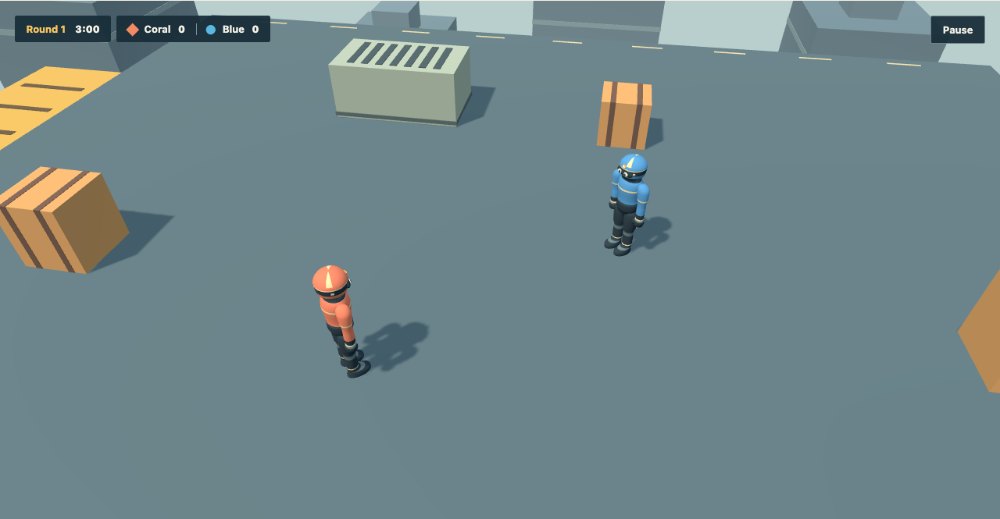

# Roof Crew fighters

Skyline's local and online arenas draw the same original work-suited fighter. Each player has a colored suit, safety boots, gauntlets, a lamp and goggles. A kit number selects a helmet pattern alongside the color. The physics playground keeps its individual body shapes for inspection.

## Model and rig

The [GLB](../../assets/fighters/roof-crew.glb) contains one indexed skinned mesh and a hierarchy of 15 bones. The [authoring source](../../tools/fighter/model.py) defines the contours in metres, surface colors and weights. The wrist, elbow, knee, shoulder, hip and waist transitions blend neighboring bodies. The renderer samples the player's kit palette using the mesh UVs. The asset includes a default vertex-color appearance for independent glTF viewers.

Run `python3 -B tools/fighter/build.py` from the repository root to regenerate the model. The generator uses the standard library and reads the [physical rest pose](../../config/character.json) to place the bone pivots at the authored joint anchors. The native server loads only simulation content.

## Playback and lifetime

For each bone the renderer precomputes its bind transform relative to its physical body. Every frame it composes that offset with the current body pose, then converts the result into the driven parent's local coordinates. This two-pass mapping supports bones listed in wire order, including a child listed before its parent. The camera includes each vertex in the bounds of every bone that influences it. Those bounds cover the blended skin during a grab or fall.

A loaded GLB supplies geometry across all players and rematches. Each instance owns its skeleton, bone texture, material and small palette texture. Scene teardown releases those instance resources. Local play waits for the asset before enabling Start. In a room, the ready handshake waits for the model alongside the renderer, engine and map. A failed download can be retried.

The online match opens when its first authoritative snapshot is accepted. The scoreboard and hazard warning render from that snapshot. The first paint can occur before WebGL initialization, and subsequent HUD updates follow the interpolated scene.

## Software rendering

Skyline recognizes SwiftShader and other common software renderers through the WebGL renderer string. On these drivers it uses a drawing-buffer pixel ratio of `0.75 × min(devicePixelRatio, 1)` and a 512-pixel basic shadow map. The default uses a ratio capped at 1.5 and a 1024-pixel filtered shadow map. An unavailable renderer string selects the default. The HUD stays at display resolution.

The roof batches the fixed trim of each physics object together, and the ten background towers share one mesh. The arena uses 19 meshes, down from 144. Crates, vents and panels still have independent transforms. Each panel retains its own warning material.

Six-second samples used the production local arena, two stationary fighters, a 1440 × 900 viewport and DPR 1. The Apple M3 Pro hardware run recorded 361 frames with a 16.7 ms median and p95. The software baseline recorded a 300 ms median at a 1440 × 844 drawing buffer. The reduced 1080 × 633 buffer produced medians from 33.3 to 83.4 ms across development runs. The final software sample recorded a p95 of 133.3 ms. The sustained eight-player performance gate remains open.

Eight profiles sharing a single SwiftShader process produced startup stalls of more than nine seconds on some clients, including reconnects. One software eight-player run passed, but repeated runs were unreliable. The macOS eight-player browser test explicitly uses ANGLE Metal. Three consecutive production matches passed on the M3 Pro with the same game, eight independent browser profiles, GPU skin-draw checks and ring-out assertions. Single-client and two-client tests continue to exercise software rendering. Human playability and independent devices across a real network still require validation.

## Verification

The final revision passed all 82 Chromium scenarios in one uninterrupted 14.6-minute run, all 58 web tests and the production TypeScript/WASM build. The native workspace suite passed 283 tests. The browser suite includes fresh reconnects, independent one-way outages, the full timed hazard sequence, two rematches, failed model downloads and eight-player rendering.

The skin test loads the shipped GLB and compares bone matrices and all deformed vertices with independent weighted body-pose calculations. It uses asymmetric limb rotations, a full turn and a translated, rotated, scaled scene root. Two fighters share geometry while their skeletons and paint are independent. Browser scenarios cover a failed model request, local retry, waiting room readiness and the normal match entry points.

The shipped model is 334,316 bytes, with 4,282 vertices and 6,560 indexed triangles in one primitive. Its SHA-256 is `c411ad2b29c7504abc87c1630ff68ab3c321460d9b32e39112e35a446301abc0`. The default mesh has no external texture files. A production Chromium check observed two distinct bone textures in local WebGL draw calls. A private eight-profile match drew eight distinct bone textures on the host and delivered the eighth fighter's ring-out to every peer. Both local and online clients recovered from a blocked model download. These checks establish rendering and game-state behavior. Player recognition of the helmet patterns at match speed still needs human testing.

A fresh Chromium 159.0.8154.6 profile loaded the production local two-player arena through Start becoming enabled. The ten same-origin navigation and resource timing entries totaled 2,566,344 encoded body bytes and 3,211,415 decoded bytes. The GLB accounted for 334,316 encoded bytes. This was the loopback Vite preview at 1280 × 800, DPR 1, on an Apple M3 Pro with 18 GiB RAM and macOS 26.6.2. The current first-playable payload meets the specification’s 10 MB target on this route. Release hosting and browser compatibility still need separate checks.

