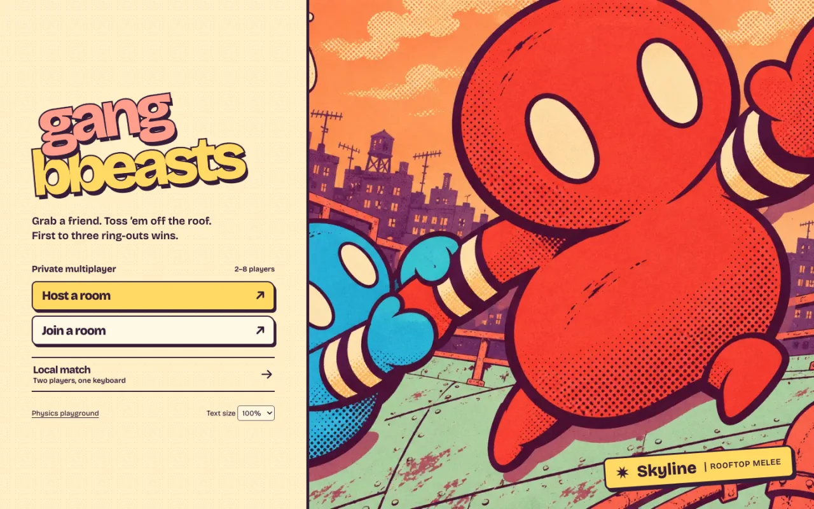
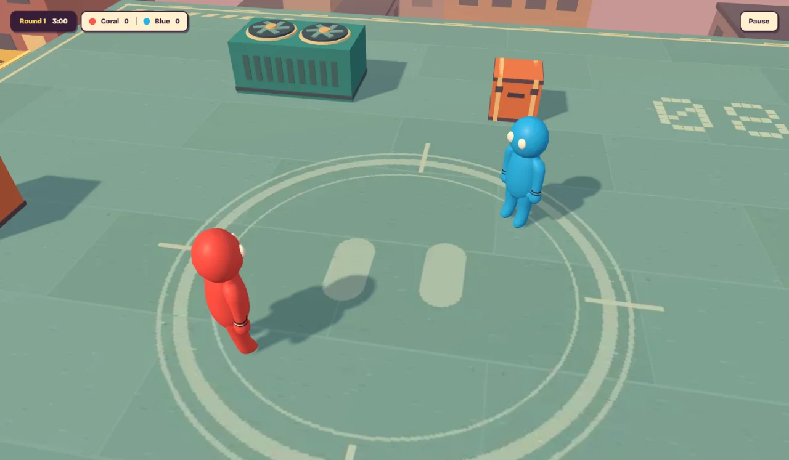
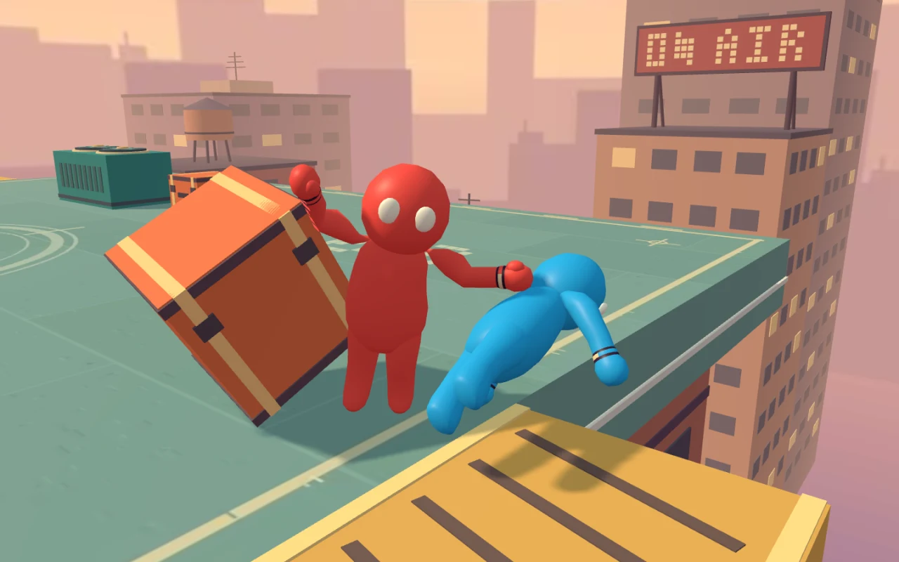

# gang bbeasts on the Studio 08 roof

Skyline is the game's single arena. The new setting is a neighborhood TV station at sunset. The roof under the fighters uses a calmer mint than the surrounding city, and a striped service walkway marks each exposed edge. A warm marquee and painted roof number give the stage two landmarks as the camera turns.

## Character and stage references

Boneloaf's gallery pairs brightly colored, expressionless characters with ordinary industrial settings that can go wrong. The oversized faces and short feet in the supplied character references read especially well during a fall. The decision here was to spend the visual detail on the roof and simplify the fighters to a head, belly, two white eyes and a pair of mittens. [Official game site](https://gangbeasts.game/) · [Double Fine screenshot gallery](https://www.doublefine.com/games/gang-beasts)

Two documented AI game demos used the renderer already in this project. The creator of *Ghoststack* describes an Astra-built Three.js platformer. The *Turbo Kart Rally* repository credits Opus 5.5 and details its procedural models, start lights, introduction and chase camera. These examples informed the choice to invest in silhouette, environment art and presentation within the existing Three.js client. [Ghoststack creator video](https://www.youtube.com/watch?v=MLZj3Gxa3i8) · [Turbo Kart Rally repository](https://github.com/bridge-mind/turbo-kart-rally)

## What players see

The character mesh uses a larger head, a low belly and limbs that taper into short feet. Its striped wristbands mark the ends of the arms in grapples. Round, raised ivory eyes identify the front of the head. The skin follows the existing fifteen physics bodies in both multiplayer modes. [Original mesh source](../../tools/fighter/model.py)

Studio 08 uses original geometry for rooftop fans, carryable equipment cases, warning paint, apartment windows, water tanks, aerials and marquee bulbs. Static decoration is batched, while moveable props and breakaway parts carry their own trim when they move. The two wrapping and deck textures can be recreated with Python and Pillow. [District](../../web/src/rendering/StationDistrict.ts) · [Roof paint](../../tools/skyline/roof_print.py) · [Sky panorama](../../tools/skyline/station_sky.py)

The title screen, room forms, local start screen, match menus and scoreboard share warm paper, dark plum ink and Bricolage Grotesque. Code entry and game controls remain live HTML. The title illustration and room preview are separate assets so neither screen needs a running GPU game to display its artwork. [Menu](../../web/index.html) · [Room preview](../../web/src/lobby/previews/skyline.webp) · [Typeface license](../../web/public/BRICOLAGE-OFL.txt)

## Title illustration

The cover illustration was generated with the built-in image generation tool and encoded as a 1350 × 900 WebP. The gameplay pictures above were captured from the project's Three.js renderer. The throw uses simulated poses eight ticks after release from the [east-edge throw fixture](../../web/tests/skyline-throw.spec.ts). [Illustration asset](../../web/src/menu/skyline-scramble.webp)

Generation prompt:

> Landscape 3:2, full bleed original screenprinted arcade game poster illustration. One persimmon-red and one swimming-pool blue soft vinyl bean wrestler tumbling together on a mint and terracotta industrial broadcast rooftop, warm apricot sky, silhouettes of dense violet brick buildings with aerials, slight fisheye, dramatic foreshortening, diagonal composition. Red bean with an enormous round head and simple raised blank ivory oval eyes, a pear-shaped belly with no neck, floppy mittens and tiny tapering feet looks toward us in the upper right, blue bean is hanging onto red's arm lower left. Fun and deadpan, exuberant action. A chunky striped sleeve cuff is their only decoration. Hand-inked thick deep aubergine contour with offset shadow shapes, extremely bold flat spot colours, coarse halftone textures, a few loose scuff marks. Strong clean graphic rhythm, sophisticated indie game box-art, not a 3D render. No lettering, typography, logos, words, interface, watermarks or frame. Both characters fill most of image and contrast with the quieter background.

## Play and rendering checks

The production web build and all 125 web unit tests passed. Chromium checks covered creating and joining private rooms, loading a model again after a failed download, starting a local match, pausing, scoring a ring-out and rematching. An eight-browser private match drew eight independently skinned fighters and the clients agreed on the surviving fighter's point. The main menu also worked at 320, 390 and 1440 pixels wide with JavaScript disabled. The narrow-screen keyboard path exercised 200% text in a match and 125% in the playground.

The existing quick rendering profile replayed an eight-fighter match in production Chromium 159 using Metal on an Apple M3 Pro at a 1440 × 900 CSS viewport, DPR 2. Each preset had a five-second warmup and one fifteen-second sample. This measures frame cadence on that machine. The benchmark uses recorded room snapshots and does not measure hosted network latency.

| Graphics | Median frame interval | 95th percentile frame interval | 95th percentile draw submission interval |
| --- | ---: | ---: | ---: |
| Low | 16.7 ms | 16.8 ms | 17.1 ms |
| Medium | 16.7 ms | 16.7 ms | 18.0 ms |
| High | 16.7 ms | 16.8 ms | 18.4 ms |

[Browser rendering profile](../../web/benchmarks/renderProfile.mjs) · [Eight-player scenario](../../web/tests/online-roster.spec.ts)
