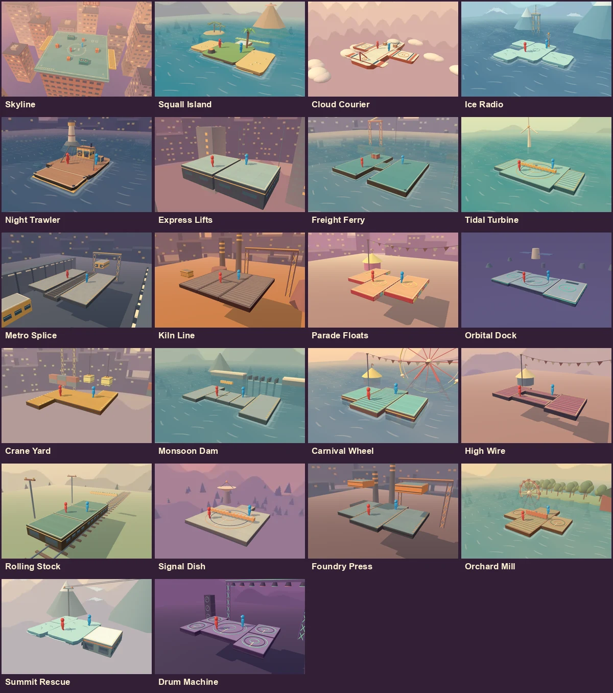

# The arena tour

## Reference roster and design

The melee target is **22 arenas**. The community melee index lists Aquarium, Billboard, Blimp, Buoy, Chutes, Containers, Elevators, Girders, Gondola, Grind, Incinerator, Lighthouse, Ring, Roof, Subway, Towers, Train, Trawler, Trucks, Vents and Wheel. Boneloaf subsequently released Crane. Alley is the separate Football pitch. [Melee stage index](https://gangbeasts.fandom.com/wiki/Category:Melee) · [Crane release](https://gangbeasts.game/posts/2024/11/19/is-it-a-bird-is-it-a-crane-update-125-crane-stage)

Boneloaf describes a deteriorating trawler with boarding sharks, ice that breaks and melts on Buoy, and escalating Elevators. Its patch notes describe a short opportunity to swim followed by gradual sinking. The release notes do not give a universal breath duration or publish a fluid solver. For this game the design calls for a shared water surface, buoyancy and drag on physical bodies, voluntary movement, time-limited survival and a grabbable route back up. [Trawler release](https://gangbeasts.game/posts/2021/12/9/a-new-stage-approaches-update-118) · [Stage-by-stage changes](https://gangbeasts.game/posts/2020/12/8/gang-beasts-aquarium-update) · [Developer update archive](https://gangbeasts.game/posts/)

The original stages use several kinds of danger. A Subway train or Trucks sign calls for a dodge. Vents changes the direction of airflow, Wheel can drop an occupied gondola, and a fighter on Girders can collapse their own footing by hitting it. Aquarium's tentacles reach into the playable space to grab a fighter. These informed different kinds of counterplay here: moving to a safe lane, timing a transfer, climbing back and breaking a physical hold. [Boneloaf stage notes](https://gangbeasts.game/posts/2020/12/8/gang-beasts-aquarium-update) · [Girders](https://gangbeasts.fandom.com/wiki/Girders) · [Aquarium](https://gangbeasts.wiki.gg/wiki/Aquarium)

## Build order and acceptance

1. Author the 21 additional sets of platforms, safe spawns, timed hazards and visual landmarks. Check all eight spawns and run the schedule for each map.
2. Introduce a deterministic shuffled map deck in Rust. WASM and the room server must choose the same map for the same series seed and round, preserve scores on rotation, and award the championship at the configured target.
3. Apply time-dependent movement to real colliders. Test displacement, water recovery, drowning and shark contact under the native simulation.
4. Switch scene geometry and camera obstacles in place when a round changes. Inspect every arena and play through representative land, water and moving-platform rounds.
5. Let hosts choose first to 3, 5 or 7. Show players the arena briefing, standings between rounds and a final champion before returning everyone to the main menu. Check packaged local and private-room paths.

## Playing a series

The host selects a target of 3, 5 or 7, either when creating the room or before starting it. Guests see that choice. Local players choose on the start screen. A shuffled deck supplies each successive round and exhausts all 22 cards before repeating. The last arena of one deck and the first of the next are always different. A draw spends a card without awarding a point.

Each countdown names the arena and describes its twist. The completed round shows the win totals before the next countdown. Once a player reaches the target, everyone sees the champion and returns to the main menu. A finished private room retires its seats and invite.

## Arena field guide

Times below are elapsed seconds of active play. Movements affect the server's colliders, including their catchable surfaces. Players see hazards change at the same points in local and private matches.

| Arena | How the round changes | Where to play |
| --- | --- | --- |
| Skyline | A warning at 90 s precedes the west and east walkway failures at 120 and 150 s. The crosswind arrives at 180 s. | A handhold on the main roof can save a fighter as a walkway falls. |
| Squall Island | The first sandbar sinks at 18 s. The far beach tilts, a breaker crosses the island, then the second beach sinks. | Cross back to basalt or swim to the jetty. |
| Cloud Courier | The plane starts banking at 16 s. At 34 s the wing tips start flexing in opposite directions. Baggage can slide. | Grapple around the fuselage or risk throwing from a moving wing. |
| Ice Radio | At 14, 19 and 24 s, floes drift outward. Each starts sinking 20 s after it breaks away. | Cross the widening gaps early or swim back to the radio floe. |
| Night Trawler | The boat rolls at 12 s. A shark starts breaching across the deck at 23 s and can tow a fighter it catches. The stern sinks at 39 s. | Shake off the shark with a swim stroke and grab the bow or plank to climb aboard. |
| Express Lifts | The cars start traveling out of sync at 13 and 16 s. Both gain a faster judder at 35 s. The service car drops at 50 s. | Change cars as the floors line up. |
| Freight Ferry | The barges slide in opposite directions at 15 s. Their boarding bridge sinks at 32 s. | Jump the gap or swim alongside a barge and catch its edge. |
| Tidal Turbine | A low rotor sweeps the platform at 15 s. The two outer service decks flood at 37 s. | Pass behind the arm or give up dry ground for a short swim. |
| Metro Splice | An express enters the center track at 14 s. A second starts from the far end at 32 s. | Use a clear stretch of track to cross between platforms. |
| Kiln Line | Two furnace doors begin tipping at 15 and 32 s. A brick cart begins crossing at 42 s. | The brick ledges remain usable when the center opens. |
| Parade Floats | Three floats start weaving at 12, 18 and 24 s. The middle float bounces at 36 s. | Transfer as floats draw level or try a lift on the rising beat. |
| Orbital Dock | The collar rotates at 16 s. Both shuttle berths begin retracting at 34 s. | Cross onto the collar while a berth still overlaps it. |
| Crane Yard | Suspended loads swing through two lanes at 14 and 29 s. An outer gantry starts tipping at 41 s. | Fight between the two load paths or use the far service deck. |
| Monsoon Dam | Spillgates sink in sequence at 15, 25 and 36 s. A flood boom sweeps the remaining crossing at 38 s. | Both gatehouses offer dry ground and a lip above the water. |
| Carnival Wheel | Opposed gondolas rise and fall at 14 s and begin rocking at 32 s. The pier sinks at 44 s. | Board a passing gondola before the pier floods. |
| High Wire | One span starts rolling at 14 s, the other sways at 19 s. The first span develops a steep tilt at 41 s. | Cross to the landing or change spans while the gap is narrow. |
| Rolling Stock | The first car starts uncoupling at 18 s and the second at 30 s. The signal gantry enters at 37 s. | Watch the gap behind you as well as the bar ahead. |
| Signal Dish | The feed arm sweeps at 13 s. The reflector starts pitching at 32 s. | The catwalk gives a fighter a way off the moving reflector. |
| Foundry Press | Two press heads cycle from 12 and 25 s. Their transfer tables begin sliding at 37 s. | Move between strokes and use the central press bed. |
| Orchard Mill | The mill paddle turns at 15 s. The two cider vats start tipping at 29 and 36 s. | Catch the bridge from the water or trade sides between paddle passes. |
| Summit Rescue | The tram starts moving at 12 s. The first and second snow shelves fall at 28 and 42 s. | Catch the tram or fight for the remaining ridge. |
| Drum Machine | Four drum pads begin bouncing at staggered intervals. At 30 s the center turntable spins. | Use the differing pad heights to separate a pair of grappling fighters. |

## Water and rescue

Eight arenas have water. The simulation applies buoyancy and drag per submerged limb and to loose crates. Fighters steer with their usual movement keys. Hold jump for an upward stroke. Grip a low lip with a hand and keep jump held to pull onto a clear surface, including a moving boat. The Night Trawler shark can briefly tow a fighter on contact and a stroke releases the hold.

The tuning here uses 12 seconds of initial flotation, followed by a three-second decline in lift. A submerged head uses a separate six-second breath reserve. Resurfacing recovers breath at three times the depletion rate. An empty breath reserve eliminates the fighter and awards the round through normal scoring. These are this game's tuning values. The visible ripples sit around the simulated waterline. The surge on Squall Island has its own moving collider.

[Authored layouts and motion schedules](../../tools/tour/build.py) · [Shared map deck and kinematics](../../crates/engine/src/arena/tour.rs) · [Water, shark and rescue behavior](../../crates/engine/src/character/duel_water.rs)

## Verification

The release Rust workspace passed 336 tests. The web production build, TypeScript, Clippy and the web unit suite passed. Fixtures exercised the moving colliders, aircraft attachments, stage shuffling, score thresholds, shark contact and release, swimming, drowning and climbing onto a rolling bow beside the wheelhouse.

Chromium rendered all 22 arenas on one canvas. A local series and a two-browser private series progressed through Skyline, Express Lifts and Rolling Stock, displayed their champion, then returned to the title. An eight-browser match agreed on the survivor and the score carried into round two. A separate packaged Night Trawler match took a swimmer off the deck, accepted a swim stroke and showed the opponent's point on both clients after the swimmer sank. Two further rooms on the normal release server opened on Metro Splice and Carnival Wheel with independent random seeds. These were automated local sessions. Stage balance across eight human players remains unmeasured.

[Browser gallery check](../../web/tests/arena-tour.spec.ts) · [Private series check](../../web/tests/support/seriesScenario.ts) · [Four arena close-ups](../verification/arena-highlights.webp)
